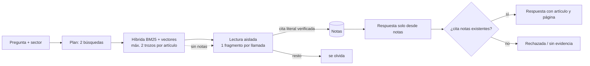

# Agente investigador de normativa · Regulation research agent

**ES** · Responde preguntas sobre 7 normas oficiales (una por sector) con un modelo local de ventana corta, citando
artículo y página. Si la norma no lo dice, se niega.

**EN** · Answers questions over 7 official laws (one per sector) using a local model with a small context window, citing
article and page. If the law does not say it, it refuses. Documentation below is in Spanish; evaluation is also
available [in English](docs/EVALUATION.md).

## Documentación
| Documento | Contenido |
|---|---|
| [Evaluación](docs/EVALUACION.md) · [Evaluation](docs/EVALUATION.md) | Métricas por etapa, comparación con líneas base y fallos |
| [Decisiones](docs/DECISIONES.md) | Qué se probó, qué falló y por qué está construido así |
| [Pruebas](../docs/PRUEBAS.md) | Inventario de tests y cobertura |

## Arquitectura


| Módulo | Responsabilidad |
|---|---|
| [`ingesta.py`](ingesta.py) | PDF oficial → secciones por artículo o apartado, sin cabeceras ni índices, con página; vectores |
| [`agente.py`](agente.py) | Búsqueda, llamadas al modelo con medición de tokens, plan, lectura, respuesta |
| [`metricas.py`](metricas.py) | Métricas puras: hit@k, MRR, percentiles, atribución de fallos |
| [`evaluar.py`](evaluar.py) | Ejecuta la evaluación (reanudable) y graba las trazas de la web |
| [`informe.py`](informe.py) | Genera la documentación de evaluación a partir de los resultados |

## Ingeniería de contexto
1. **Nada largo se acumula**: cada fragmento se lee en su propia llamada y después se olvida.
2. **Memoria comprimida y verificable**: solo pasa una nota con una cita que el código comprueba contra el original.
3. **Respuesta cerrada**: la última llamada ve la pregunta y las notas, nada más.
4. **Presupuesto visible**: cada llamada informa de los tokens reales (`prompt_eval_count` de Ollama).
5. **Coste asumido**: más llamadas y más tokens totales que un RAG simple. La evaluación lo cuantifica.

## Ejecutar
```
pip install -r requirements.txt
ollama pull qwen2.5:7b-instruct
ollama pull nomic-embed-text
python agente/ingesta.py          # descarga las normas de las fuentes oficiales e indexa
python vivo/servidor.py           # http://127.0.0.1:8800/agente.html
python agente/evaluar.py          # evaluación completa (≈15 min en local)
python pruebas.py                 # todos los tests
```

## Límites
- Pocas preguntas y un solo modelo: orientan, no demuestran.
- La corrección se mide por patrón sobre el dato esperado, no con un juez.
- No sustituye asesoramiento jurídico; las normas pueden haber cambiado desde la descarga.
